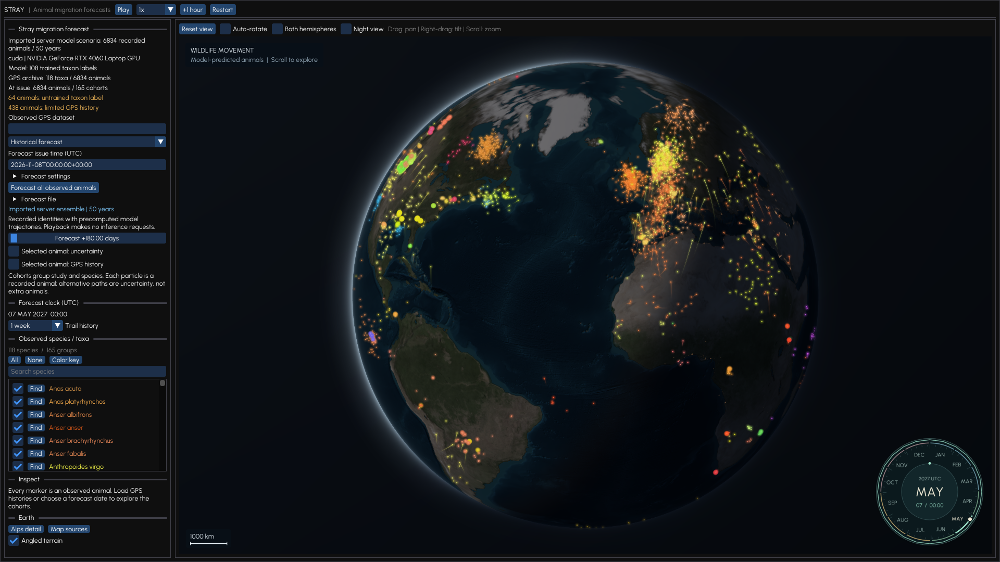
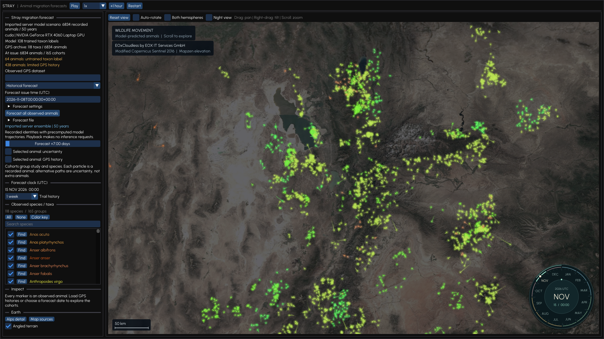

# Stray

**Follow animal migration across Earth.**

A native C++ atlas powered by animal movement models and real GPS histories. Explore animal cohorts, follow their trails, and move from the globe to satellite terrain.



- **Forecast on your GPU.** Continuous local CUDA inference, with precomputed scenarios available for uninterrupted playback.



## Run locally

Requires CMake 3.24+, a C++20 compiler, OpenGL 3.2+, libcurl and nlohmann-json. Supply the model bundle at `htb-gui/models/server-repaired-v2`, then run from the repository root:

```sh
python3 -m venv htb/.venv
htb/.venv/bin/python -m pip install -e './htb[dev]'
cd htb-gui
./run-local
```

Use a PyTorch build compatible with your CUDA installation. The launcher builds the viewer, starts the local inference service and opens the atlas.

## Play the 50-year demo

Place `forecast.json` and `positions.f32` together in `htb-gui/runs/server-50y-20261108`, then run from `htb-gui`:

```sh
ATLAS_FORECAST=runs/server-50y-20261108/forecast.json ./run-local
```

Press **Play** and choose a speed. Omit `ATLAS_FORECAST` to start continuous local inference instead. Model bundles, GPS archives and generated forecasts are supplied separately and kept outside Git.

## Inside the repository

| Project                       | Contents                                                                 |
| ----------------------------- | ------------------------------------------------------------------------ |
| [Atlas](htb-gui/)    | C++20/OpenGL desktop viewer, playback controls and inference integration |
| [Stray models](htb/) | Model architecture, data preparation, training and evaluation            |

[Viewer code](htb-gui/src/) · [Model code](htb/wildcast/) · [Screenshots and figures](docs/submission/)

The demo is a recursive model scenario, not a validated 50-year ecological forecast. Markers represent recorded animal identities; cohorts group studies and taxa rather than verified biological colonies. Taxon labels include some classifications above or below species level.

Upstream dependency licenses remain in [htb/third_party](htb/third_party/). Map imagery credits: NASA, NOAA and [EOxCloudless by EOX](https://cloudless.eox.at/) (modified Copernicus Sentinel data, CC BY 4.0).
