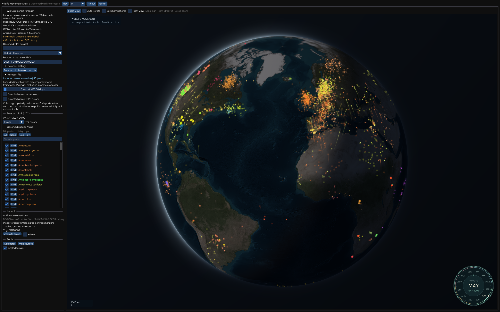
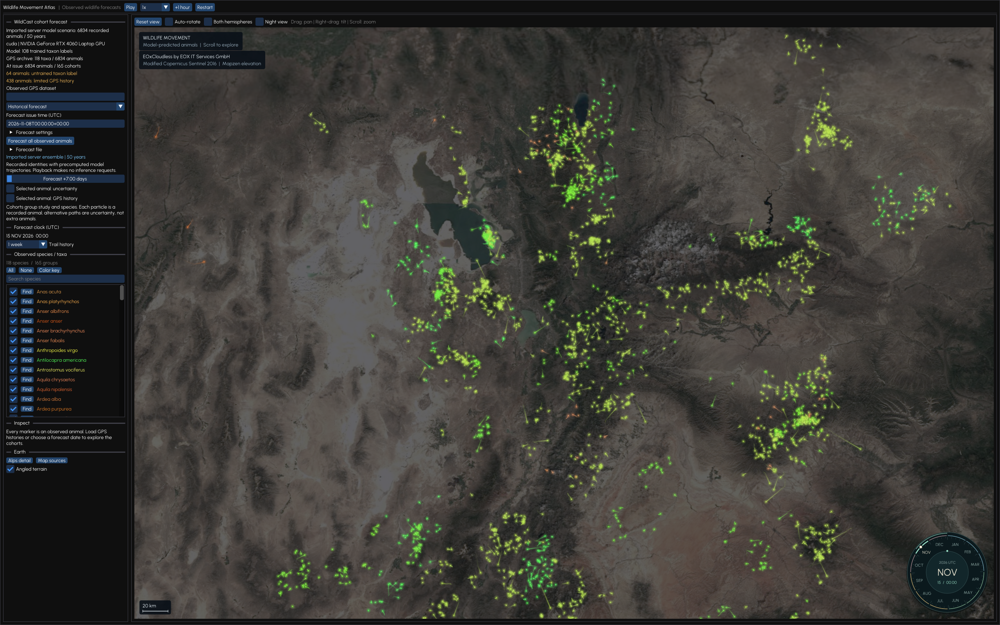

# Stray

**Follow animal migration across Earth.**

A native C++ atlas powered by WildCast movement models and real GPS histories. Explore glowing animal cohorts, follow their trails, and move from the globe to satellite terrain.



| Tracked animals | Observed taxon labels | Demo timeline |
| :---: | :---: | :---: |
| **6,834** | **118** | **2026–2076** |

- **Explore at any scale.** Pan, tilt and zoom from Earth to city/state level.
- **Follow each animal.** Distinct colors, softly glowing trails and smooth bird movement; related animals share a palette.
- **Forecast on your GPU.** Continuous local CUDA inference, with precomputed scenarios available for uninterrupted playback.



*Actual native-app captures. Both views use a one-week trail history.*

## Run locally

Install the [native dependencies](htb-gui/README.md#setup-and-options) and supply the [verified model bundle](htb-gui/docs/model-deployment.md) at `htb-gui/models/server-repaired-v2`. Then, from the repository root:

```sh
python3 -m venv htb/.venv
htb/.venv/bin/python -m pip install -e './htb[dev]'
cd htb-gui
./run-local
```

Use a PyTorch build compatible with your CUDA installation. The launcher builds the viewer, starts the local inference service and opens the atlas.

## Play the 50-year demo

Place `forecast.json` and `positions.f32` together in `htb-gui/runs/server-50y-20261108`, then run from `htb-gui`:

```sh
ATLAS_FORECAST=runs/server-50y-20261108/forecast.json ./run-local
```

Press **Play** and choose a speed. Omit `ATLAS_FORECAST` to start continuous local inference instead. Model bundles, GPS archives and generated forecasts are supplied separately and kept outside Git.

## Inside the repository

| Project | Contents |
| --- | --- |
| [Atlas](htb-gui/README.md) | C++20/OpenGL desktop viewer, playback controls and inference integration |
| [WildCast](htb/README.md) | Model architecture, data preparation, training and evaluation |

[Controls and setup](htb-gui/README.md) · [Model and data provenance](htb-gui/docs/model-deployment.md) · [Rendering details](htb-gui/docs/rendering.md) · [Screenshot captures](docs/screenshots/README.md)

The demo is a recursive model scenario, not a validated 50-year ecological forecast. Markers represent recorded animal identities; cohorts group studies and taxa rather than verified biological colonies. Taxon labels include some classifications above or below species level.

Upstream models and map assets retain their [dependency notices](htb-gui/third_party/README.md) and [imagery attribution](htb-gui/README.md#map-data-and-attribution).
